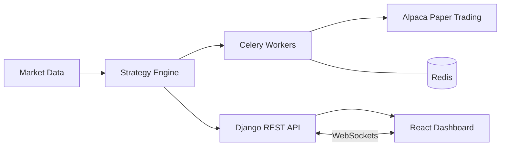

<!-- ===================== HEADER ===================== -->
<div align="center">

[](https://git.io/typing-svg)


</div>

---

## 👋 About me

I'm an **Applied Mathematics & Computer Science student** working at the intersection of **software engineering, machine learning, quantitative finance, and fintech**.

I like taking a mathematical or financial idea and shipping it as something that actually runs: a validated ML pipeline, a trading backend with a live dashboard, or a data tool that helps someone make a better decision.

```python
class JuanSerna:
    studying   = ["Applied Mathematics", "Computer Science"]
    focus      = ["Quant Finance", "Machine Learning", "FinTech", "Backend Engineering"]
    approach   = "Mathematical rigor + clean, testable code"
    currently  = "Building systematic trading tools & applied ML projects"
    looking_for = "Roles where math, programming and problem-solving meet"
```

---

## 🚀 What I'm working on

| Area | What it looks like in practice |
|---|---|
| 📈 **Quantitative Finance & Trading** | Algorithmic trading systems, market data pipelines, quantitative analysis, systematic strategies |
| 🤖 **Machine Learning & Data Science** | Predictive modeling, feature engineering, model evaluation, time-aware validation |
| 💻 **Software Engineering** | Python backends, REST APIs, React apps, distributed task processing, automation |
| 💰 **FinTech** | Personal finance, financial behavior, investing, financial infrastructure |
| 🧮 **Applied Mathematics** | Probability, statistics, optimization, graph theory, numerical & computational methods |

---

## 🛠️ Tech stack

**Languages**


**Data & Machine Learning**


**Backend & Distributed Systems**


**Frontend**


**Infrastructure & Tools**


**Finance & Quantitative Analysis**


---

## 📌 Selected projects

### 🤖 [FlyRank — SEO Content Performance & Machine Learning](https://github.com/NoT-Serna/Juan_Serna_FlyRank)

> Can content-performance data tell us which SEO pages deserve human review?

A machine learning project that identifies SEO pages likely to need attention, and turns model output into something a human team can act on.

- 🦆 Analyzed large-scale content performance data with **DuckDB** and **Parquet**
- 📏 Compared a **rule-based baseline** against **logistic regression**
- ⏳ Used **time-based validation** to measure generalization across different periods, not just random splits
- 📋 Built a **ranked action playbook with reason codes** to support human review and decision-making

`Python` `Machine Learning` `DuckDB` `Feature Engineering` `Temporal Validation`

📄 [**Research paper**](https://not-serna.github.io/Juan_Serna_FlyRank/paper/) · 💻 [**Source code**](https://github.com/NoT-Serna/Juan_Serna_FlyRank)

---

### 📈 [Watcher_Algo — Algorithmic Trading System](https://github.com/NoT-Serna/Watcher_Algo)

> An automated trading platform combining market data, technical indicators, and systematic logic.

- 🐍 Python backend for trading logic and broker integration
- 🔌 **Django REST Framework** APIs exposing application functionality
- ⚙️ **Celery + Redis** for background tasks and scheduling
- 📊 **React** dashboard with real-time updates over **WebSockets**
- 🧪 Systematic strategies explored through **Alpaca paper trading**

`Python` `Django` `Celery` `Redis` `React` `WebSockets` `Alpaca`



---

### 💰 Avantra — FinTech & Personal Finance

> Helping people understand and improve their financial behavior with data-driven tools.

**Long-term vision:** a single platform that integrates

- 📒 Financial tracking
- 🧭 Personalized financial guidance
- 🏦 Behavior-informed lending
- 📈 Investing

`FinTech` `Python` `REST APIs` `Financial Data` `Applied AI`

---

### 🏎️ Formula 1 Track Geometry

> What does the shape of a circuit say about how a lap is driven?

An applied mathematics project that uses real telemetry to study the geometry and character of Formula 1 circuits.

- 📡 Processed telemetry with **FastF1**
- 📐 Applied **numerical methods** and **differential geometry** concepts
- 🎨 Explored circuit characteristics through analysis and visualization

`Applied Mathematics` `Numerical Methods` `FastF1` `Data Visualization`

---

## 🎯 What I'm looking for

I'm interested in opportunities in:

<div align="center">

**Quantitative Finance** · **FinTech** · **Machine Learning** · **Data Science** · **Backend Engineering** · **Algorithmic Trading**

</div>

Especially roles where I can combine **mathematical reasoning, programming, and practical problem-solving** to build useful systems.

---

## 📊 GitHub stats

<div align="center">


</div>

---

## 📫 Let's connect

<div align="center">

[](https://github.com/NoT-Serna)
[](https://www.linkedin.com/in/notserna)
[](mailto:jserna7856@gmail.com)

*Feel free to explore my repositories, open an issue, or reach out.*


</div>
